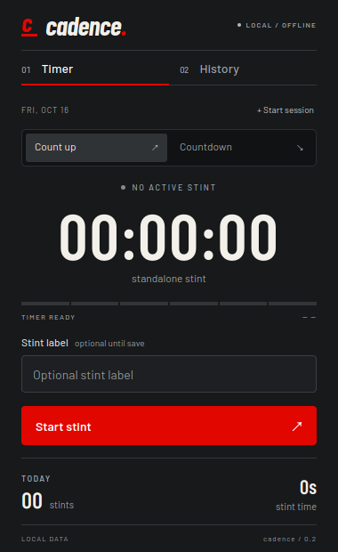
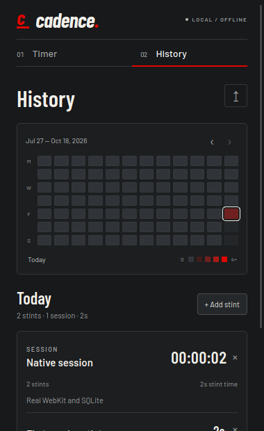

# cadence

cadence is a compact, offline Linux tracker for focused blocks of time. A stint can run independently or belong to a session. Sessions have their own elapsed time and can contain any number of count-up or countdown stints. Saved activity appears in a twelve-week history grid.

## Screenshots

<p align="center">
  
  
</p>

<p align="center">
  
</p>

Use the small mini-mode button in the top bar to switch to a 360 × 72 floating capsule. The capsule stays above other windows, can be dragged, and provides timer pause/resume, finish, review, and return-to-normal controls. The normal window remains resizable but cannot be maximized.

## Development

The initial target is Pop!_OS / Ubuntu 24.04 on x86_64, validated on KDE/X11. Install Node.js 22.12 or newer, a current stable Rust toolchain, and the Linux build dependencies:

```sh
sudo apt install build-essential pkg-config libwebkit2gtk-4.1-dev libgtk-3-dev libayatana-appindicator3-dev librsvg2-dev patchelf
npm ci
npm run tauri dev
```

`npm run dev` serves the Svelte interface for layout work. Timer, session, history, and file operations require the Tauri desktop app.

## Checks and release

```sh
npm run check
npm test
npm run test:core
npm run test:ui
npm run tauri build -- --bundles deb,appimage
```

The browser tests use Chrome at `/usr/bin/google-chrome` by default; set `CHROME_BIN` to another Chromium executable. Rust tests cover timing, sessions, SQLite migrations, recovery, date attribution, import validation, and backup round trips. `scripts/native-smoke.py` exercises the built app through tauri-driver and WebKitWebDriver with an isolated data directory.

Release files are generated under:

- `src-tauri/target/release/bundle/deb/cadence_0.2.2_amd64.deb`
- `src-tauri/target/release/bundle/appimage/cadence_0.2.2_amd64.AppImage`

Install the Debian package system-wide:

```sh
sudo apt install ./src-tauri/target/release/bundle/deb/cadence_0.2.2_amd64.deb
```

Or install it for the current user without administrator access:

```sh
./scripts/install-user.sh ./src-tauri/target/release/bundle/deb/cadence_0.2.2_amd64.deb
```

The user installer extracts cadence to `~/.local/share/cadence-app`, creates a launcher in `~/.local/share/applications`, and links `~/.local/bin/cadence`. It does not install missing runtime libraries.

The AppImage can run directly after making it executable:

```sh
chmod +x src-tauri/target/release/bundle/appimage/cadence_0.2.2_amd64.AppImage
./src-tauri/target/release/bundle/appimage/cadence_0.2.2_amd64.AppImage
```

## Timer and session behavior

- cadence permits one unfinished stint and one active session at a time.
- A stint started during a running session joins that session automatically. Without an active session it is saved as a standalone stint.
- A session records its full elapsed duration, including gaps between stints. Paused time is excluded.
- Ending a session requires its current stint to be saved or discarded first. The ended session remains in review until saved or discarded.
- Countdowns default to 25 minutes and stop at their target. They remain in review until saved or discarded.
- Closing the window leaves timing active in the tray. The tray can reopen cadence, pause or resume timing, and quit. A second launch focuses the existing instance.
- Explicit quit and system suspend pause and persist both the active session and stint. Resume is always explicit.
- Running progress is checkpointed every five seconds. Recovery restores unfinished work paused at the last checkpoint, excluding subsequent downtime.

Saved sessions use the local date on which the session ends. Their member stints appear on the same effective date. Standalone stints use their own finish date. Editing a session date moves its member stints with it in history; deleting a session preserves its stints as standalone records. Manual stints can be assigned to any saved session.

The activity grid counts saved stints at four intensity levels: one, two, three, and four or more. Empty sessions appear in daily history but do not increase grid intensity.

## Data and backups

The SQLite database lives at `$XDG_DATA_HOME/io.cadence.desktop/cadence.sqlite3`, normally `~/.local/share/io.cadence.desktop/cadence.sqlite3`. cadence has no account, cloud service, analytics, or external font requests.

Use the export control in History to create CSV or JSON. CSV includes explicit millisecond units, ISO dates and timestamps, record type, original and effective stint dates, and session membership. JSON backups use version 2 and include both `sessions` and `stints`. Version 1 stint-only backups remain importable.

Import validates the complete file before showing a preview. Records with identical stable IDs and contents are skipped. Conflicting IDs, invalid session references, duplicate IDs, unsupported versions, and malformed records reject the import without changing the database. Accepted records are committed atomically. Files larger than 50 MB are rejected.

For a direct database copy, quit cadence and copy the complete application data directory. Copying only the database while cadence is running can omit data stored in SQLite's WAL file.

## Structure

- `src/`: Svelte interface, typed IPC adapter, and calendar helpers.
- `src-tauri/src/lib.rs`: timer and session state machines, SQLite migrations, history, CSV, and JSON backup handling.
- `src-tauri/src/main.rs`: Tauri commands, checkpoints, tray, single-instance behavior, notifications, and suspend handling.
- `tests/`: calendar and browser interaction tests.
- `scripts/`: user installation, asset generation, and native desktop smoke testing.

Barlow and Barlow Condensed are bundled under the SIL Open Font License; license copies ship in `public/licenses/`. The cadence wordmark uses the bundled italic Barlow Condensed face. Wayland and distributions outside the initial Ubuntu-family target remain follow-up validation work.
